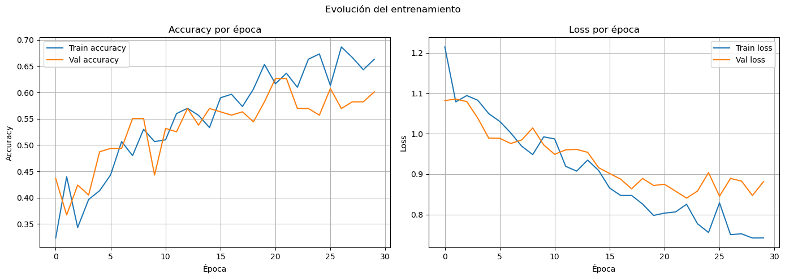
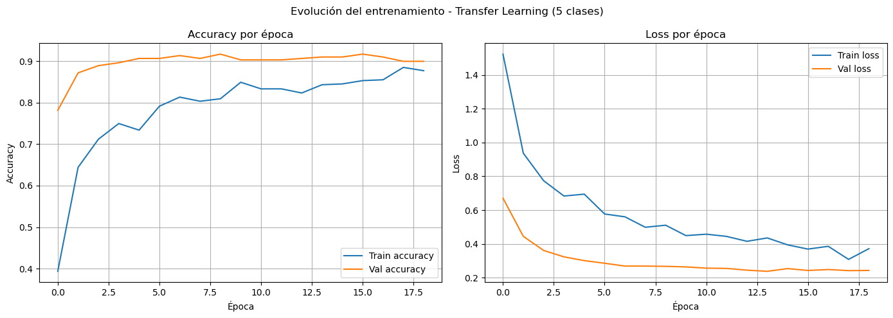
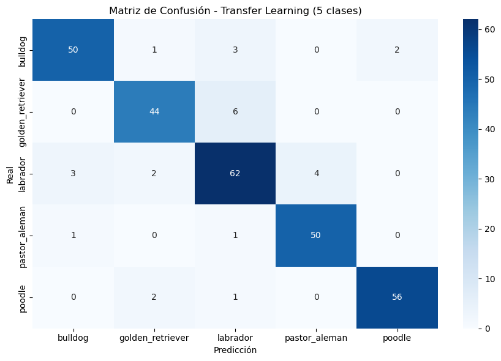

[README.md](https://github.com/user-attachments/files/35107200/README.md)
# 🐕 RNC-Dogs: clasificador de razas de perros con redes neuronales convolucionales

Proyecto de visión por computador que identifica la raza de un perro a partir de una imagen. Compara dos enfoques sobre el mismo problema:

1. **CNN entrenada desde cero** con 3 razas.
2. **Transfer learning con MobileNetV2** ampliando a 5 razas.

Incluye evaluación con matriz de confusión y métricas por clase, interpretabilidad con **Grad-CAM** y una **interfaz web con Gradio** para probar el modelo subiendo una foto.

## Resultados

| Enfoque | Razas | Imágenes (train / test) | Accuracy | F1 macro |
|---|---|---|---|---|
| CNN desde cero | 3 | 300 / 158 | 57,0 % | 0,55 |
| **Transfer learning (MobileNetV2)** | **5** | 503 / 288 | **91,0 %** | **0,91** |

### 1. CNN desde cero (3 razas)

Tres bloques Conv2D + MaxPooling (32-64-128 filtros), capa densa de 256 neuronas, Dropout y salida softmax. Con aumentación de datos y *Early Stopping*.



La red aprende (supera claramente el 33 % del azar), pero rinde de forma modesta: con solo 100 imágenes por raza es difícil que una CNN entrenada desde cero aprenda características robustas. La clase de la carpeta `bulldog` es la más difícil (recall de 0,27).

| Clase | Precision | Recall | F1 |
|---|---|---|---|
| bulldog | 0,42 | 0,27 | 0,33 |
| golden retriever | 0,63 | 0,84 | 0,72 |
| pastor alemán | 0,60 | 0,63 | 0,62 |

### 2. Transfer learning con MobileNetV2 (5 razas)

Se reutiliza MobileNetV2 preentrenada con ImageNet como extractor de características (capas congeladas) y se entrena solo un clasificador nuevo: `GlobalAveragePooling2D → Dense(128) → Dropout → Dense(5, softmax)`.




| Clase | Precision | Recall | F1 |
|---|---|---|---|
| bulldog | 0,93 | 0,89 | 0,91 |
| golden retriever | 0,90 | 0,88 | 0,89 |
| labrador | 0,85 | 0,87 | 0,86 |
| pastor alemán | 0,93 | 0,96 | 0,94 |
| poodle | 0,97 | 0,95 | 0,96 |

Los errores más frecuentes se dan entre razas visualmente parecidas: 6 de los 50 golden retriever se clasifican como labrador, y el labrador es la clase con menor F1.

### Lectura de los resultados

El transfer learning mejora más de 30 puntos de accuracy respecto a la CNN desde cero, a pesar de ser un problema con más clases. La comparación no es completamente directa, porque el segundo experimento usa más imágenes y más razas, pero muestra la ventaja de reutilizar características aprendidas en un dataset grande cuando se dispone de pocos datos propios.

## Datos

Las imágenes proceden del [Stanford Dogs Dataset](http://vision.stanford.edu/aditya86/ImageNetDogs/) (Khosla et al., 2011), derivado de ImageNet. Se ha usado un subconjunto de unas 100 imágenes por raza para entrenamiento y entre 50 y 71 para test. Todas las imágenes pertenecen a sus autores originales y el dataset se distribuye para uso en investigación y sin fines comerciales.

| Carpeta | Contenido |
|---|---|
| `imagenes_perros/` | 3 razas (notebook 01) |
| `imagenes_perros_5clases/` | 5 razas (notebook 03) |
| `*/prueba/` | Imágenes de demostración para la interfaz |

Cada carpeta tiene la estructura `train/`, `test/` y `prueba/`, con una subcarpeta por raza.

## Contenido del repositorio

```
├── 01_entrenamiento.ipynb        # CNN desde cero: datos, aumentación, entrenamiento, evaluación y Grad-CAM
├── 02_prediccion_gradio.ipynb    # Carga del modelo, predicción e interfaz web con Gradio
├── 03_reentrenamiento.ipynb      # Transfer learning con MobileNetV2 y 5 razas
├── modelo_perros.keras           # Modelo CNN (3 razas)
├── modelo_perros_5clases.keras   # Modelo MobileNetV2 (5 razas)
├── imagenes_perros/
├── imagenes_perros_5clases/
├── img/                          # Gráficos usados en este README
└── requirements.txt
```

## Cómo ejecutarlo

Desarrollado y probado en Windows con Python 3.

```bash
git clone https://github.com/miguellopezlopezlopez/RNC-Dogs.git
cd RNC-Dogs
pip install -r requirements.txt
jupyter notebook
```

Las imágenes y los modelos ya están incluidos, así que no hace falta descargar nada más.

1. Para reentrenar, ejecuta `01_entrenamiento.ipynb` (CNN) o `03_reentrenamiento.ipynb` (transfer learning).
2. Para probar el modelo con la interfaz web, ejecuta `02_prediccion_gradio.ipynb` y abre el enlace local que muestra Gradio.

## Limitaciones

- **El conjunto de test también se usa como validación** durante el entrenamiento (para el *Early Stopping* y para elegir la mejor época), por lo que las métricas pueden ser algo optimistas. Lo ideal es separar un conjunto de validación del de test.
- Los datasets son pequeños (unas 100 imágenes por raza), por lo que los resultados pueden variar con otra partición.
- Las imágenes de `prueba/` son copias de imágenes que ya están en `train/` o `test/`. Sirven para demostrar la interfaz, no para evaluar el modelo.
- El modelo solo distingue las razas con las que se ha entrenado: ante cualquier otro perro devolverá igualmente una de ellas.

## Tecnologías

Python · TensorFlow / Keras · MobileNetV2 · scikit-learn · Gradio · matplotlib · seaborn · NumPy
